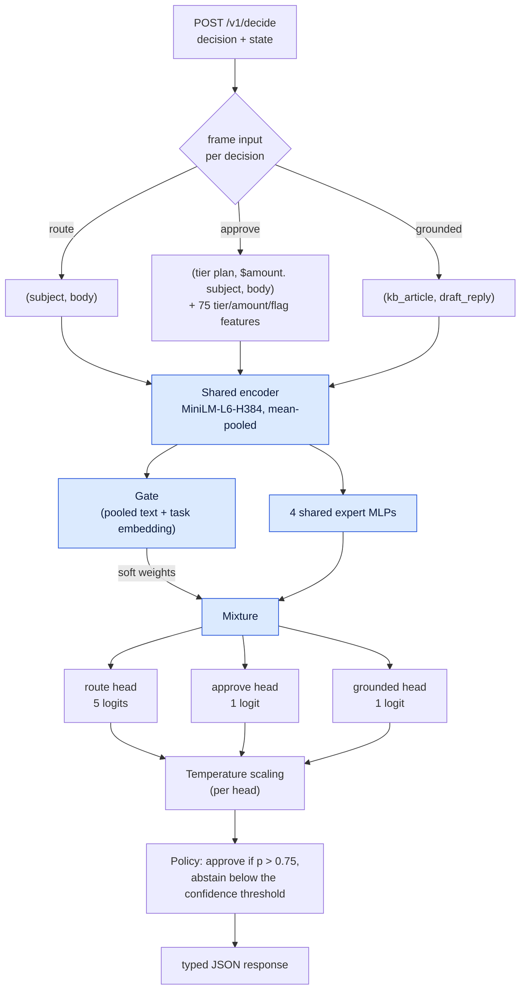

# Decide: a CPU-only typed decision engine

One shared model answers three typed questions about a support ticket
(`route`, `approve`, `grounded`) behind `POST /v1/decide`, with calibrated
probabilities and a deliberate abstention policy. No network calls at serving
time; inference is a single int8 ONNX graph on CPU.

## Run it (clean 4-core Linux box)

```bash
pip install -r requirements.txt && uvicorn app:app --host 0.0.0.0 --port 8000 --workers 1
```

The trained weights are committed in `artifacts/` (int8 ONNX, 24 MB), so
there is nothing to download. Then, with `data/dev.jsonl` in place:

```bash
python selfcheck.py --url http://localhost:8000/v1/decide
```

## Architecture: where the sharing happens



Blue = shared by every decision type. More diagrams (request lifecycle,
training pipeline, approve and abstention logic) are in
[`docs/ARCHITECTURE.md`](docs/ARCHITECTURE.md).

- **Encoder and experts are shared** (`DecideNet` in `train_encoder.py`). Every
  request, whatever its decision type, runs through the same weights in the same
  ONNX graph (`artifacts/decide.onnx`). Only the last Linear layer differs.
- **The questions are not the same shape**, so each one is framed for what it
  compares (`decide/inputs.py`): routing reads the ticket, approval reads the
  ticket plus structured features (the policy is mostly a per-tier amount
  threshold with red-flag overrides), and grounding is a cross-encoded
  premise/hypothesis pair, which is why we start from an encoder pre-trained
  as a cross-encoder over text pairs.
- **Adding a fourth decision** is one new task-embedding row, one Linear head
  and its training examples. The encoder and experts are reused, and inference cost
  does not change.

## Calibration and abstention

- Training holds out 1,000 train records. One temperature per head is
  fitted on them by NLL (Guo et al. 2017).
- `approve` commits to "yes" only when `p_true > 0.75`: a wrong approval costs
  3x a wrong hold, so the Bayes threshold is 3/(3+1).
- Route and grounded abstain on their least-confident ~15%; approve abstains in
  the lopsided band 0.15 < p < 0.79 (wrong approvals cost 3x). Thresholds are in
  `artifacts/policy.json` (chosen by `tune_policy.py`), so declared coverage
  sits above the 80% target.

## Training

GPU training ran on a Kaggle T4 (`kaggle/decide_train.ipynb` runs
`train_encoder.py`): multi-task fine-tuning, one task per batch, 5 epochs,
AdamW + one-cycle schedule, fp16. It exports to ONNX and applies dynamic int8
quantisation. Then `python tune_policy.py artifacts` writes the abstention
policy.

The served weights are trained on `train.jsonl` only. 4-fold
cross-validation (`kaggle/decide_cv.ipynb`, `cv_analyze.py`) was used to check
consistency and choose epochs and the approve abstention band; its fold models
are not served.

`train_baseline.py` is the gate-1 classical baseline (TF-IDF + logistic
regression / LightGBM). `model.py` falls back to it if `artifacts/decide.onnx`
is absent.

## Pretrained components and licences

| Component | Use | Licence |
|---|---|---|
| `cross-encoder/ms-marco-MiniLM-L6-v2` (Hugging Face) | encoder initialisation (served model) | Apache-2.0 |
| `cross-encoder/nli-MiniLM2-L6-H768` (Hugging Face) | compared backbone, not served | Apache-2.0 |

Libraries: PyTorch (BSD-3), Transformers (Apache-2.0), ONNX Runtime (MIT),
tokenizers (Apache-2.0), FastAPI (MIT), Uvicorn (BSD-3), scikit-learn (BSD-3),
LightGBM (MIT).

## Results (public dev split, full self-check)

| | score |
|---|---|
| classical baseline (`train_baseline.py`) | 78.45 |
| shared encoder, H768 NLI backbone | 73.65 (more accurate grounding, too slow) |
| **shared encoder + MoE, H384 (served, trained on train only)** | **83.75** |

As a consistency check, evaluation-only models trained on 4 folds of train + dev scored **82.56 ± 1.28** on unseen rows (folds 80.5 to 83.9), so dev is not a lucky split. The served model is trained on `train.jsonl` only and never sees dev.

Mean p95 is about 11 ms per call on a quiet machine. Full numbers are in `results.json`; accuracy,
calibration and failure modes are in `model_card.md`.

## One trade-off we made

We served the smaller H384 backbone over the H768 NLI one. H768 grounds
perfectly on dev (F1 1.00 vs 0.99) but costs about 1.7x the latency, and
latency is 20% of the score with full marks only at 25 ms. A 0.01 F1 gain on
one decision does not pay for that.

## Docs

- `docs/report/report.pdf`: 4-page technical report (LaTeX source alongside)
- `docs/ARCHITECTURE.md`: diagrams of the model, request path, training and policy
- `docs/API.md`: request and response reference
- `docs/TRAINING.md`: how to retrain (Kaggle GPU) and rebuild the policy
- `docs/DEMO.md`: three-minute demo script, including a refusal case
- `docs/PLAN.md`: plan, status and untried ideas

## Layout

```
app.py              HTTP layer (starter, unchanged)
model.py            DecisionModel: policy (thresholds, abstention) over a backend
decide/inputs.py    per-decision input framing for the shared encoder
decide/tabular.py   approve features (tier x amount cuts, red flags)
decide/features.py  duration normalisation ("two weeks" == "14 days")
decide/runtime.py   ONNX Runtime CPU backend
train_encoder.py    multi-task training + ONNX export (GPU)
tune_policy.py      abstention thresholds from the calibration holdout
train_baseline.py   gate-1 classical baseline (needs requirements-train.txt)
kaggle/decide_train.ipynb  the Kaggle notebook used for training
```
