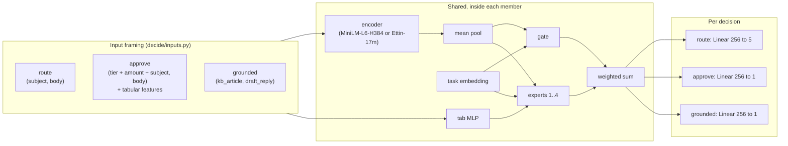
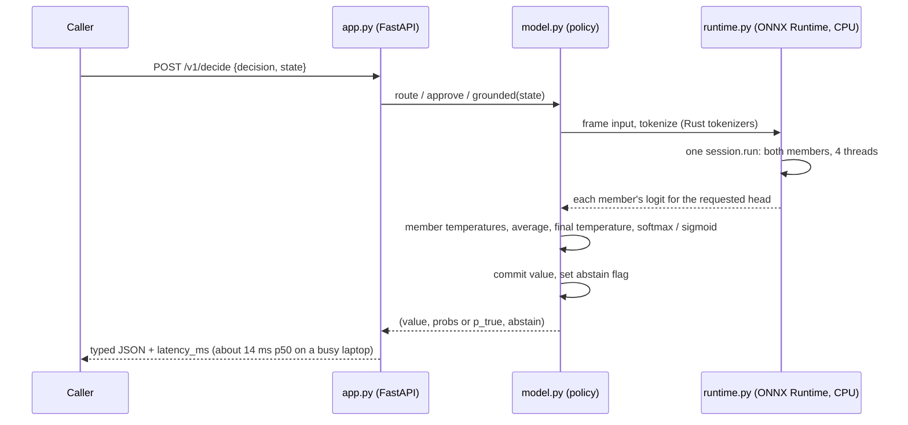
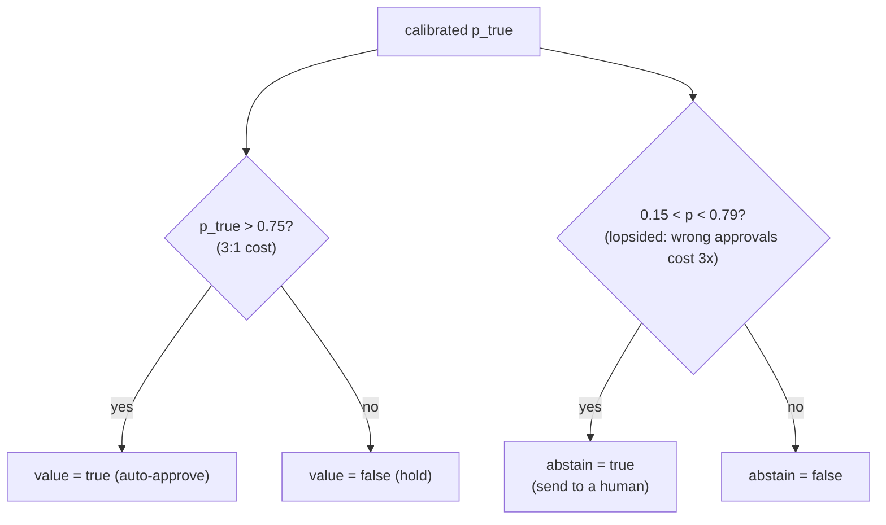
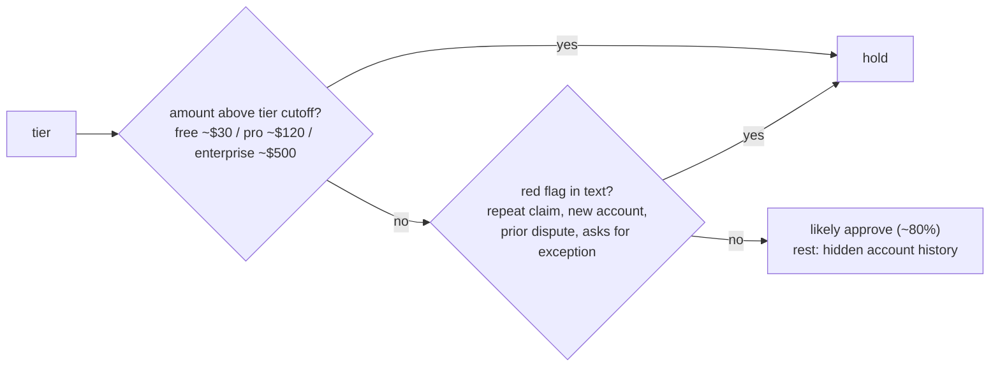
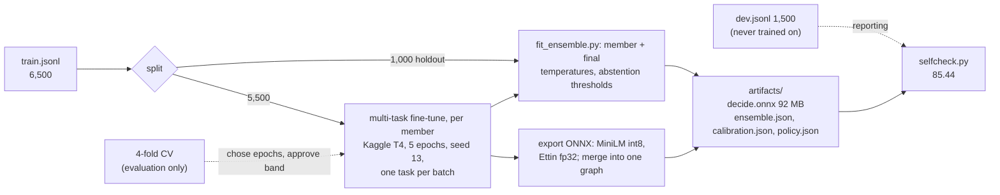

# Architecture diagrams

## 1. One model, three decisions

The served model is an ensemble of two members in one ONNX graph: MiniLM-L6-H384
(int8) and Ettin-17m (fp32). Each member has the structure below, and one
`session.run` computes both. Inside each member, every request runs through the
same encoder and the same experts. The decision type only changes how the input
is framed, which task embedding the gate sees, and which output head's logit is
read. The two members' temperature-scaled logits are averaged, then a final
temperature is applied (`decide/runtime.py` `EnsembleBackend`).

Adding a fourth decision = one task-embedding row + one Linear head + its
training examples. Nothing in the blue path changes, and latency stays the same.

## 2. Request lifecycle

## 3. Approve and abstention logic

The thresholds come from `artifacts/policy.json`, set on the training
holdout so about 85% of requests are answered (target 80%). `route` abstains
when its top-queue probability is under 0.892; `grounded` when
max(p, 1-p) is under 0.9957.

What the approve head learned from the labels:

## 4. Training pipeline

