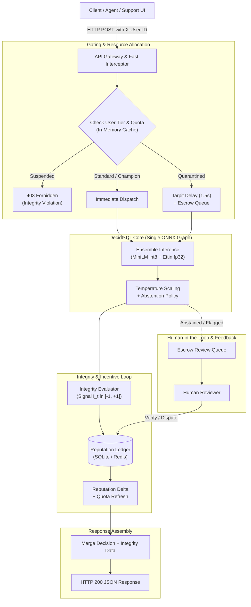
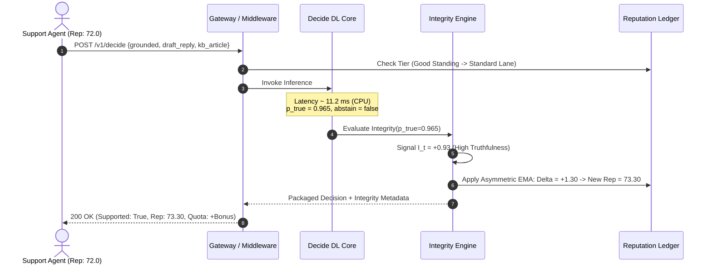
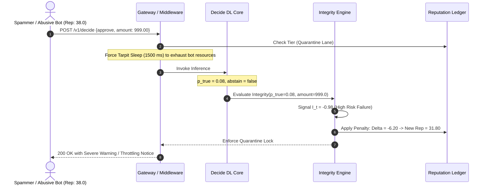

# Decide v2: End-to-End System Architecture

> **Complete Platform Blueprint with Integrity Incentive Engine & Resource Protection**  
> An integrated view of the CPU-first Multi-Task Decision Service, Adaptive Reputation Gating, and Hardware Resource Protection.

---

## 1. Architectural Overview

**Decide v2** extends the sub-25ms CPU-only decision engine into a self-protecting, closed-loop platform. By coupling calibrated deep learning probabilities ($p_{\text{true}}$, routing entropy, selective abstention) with an in-memory reputation ledger, the system simultaneously executes inference and evaluates the integrity of the user's workload.

### 1.1. System Context Diagram



---

## 2. Core Subsystems & Components

### 2.1. Ingestion & Gating Middleware (`app/middleware/reputation.py`)
Intercepts incoming requests before reaching the deep learning model:
- **Identity Extraction:** Extracts and validates `X-User-ID` and token.
- **Quota & Tier Evaluation:** Queries the localized in-memory cache ($O(1)$ lookup time $< 0.1\text{ ms}$).
- **Rate-Limiting & Tarpitting:**
  - *Trusted Users:* Bypass throttle queues; access priority worker pool.
  - *Quarantined Users:* Experience an intentional delay (1500 ms) and lowered concurrency limits to deter automated abuse and conserve CPU cycles.

### 2.2. Decision Core (`decide/runtime.py` & `decide/inputs.py`)
Preserves the high-performance CPU characteristics of Decide v1:
- **Shared Input Framing:** Builds task-specific representations for `route`, `approve`, and `grounded`.
- **Fused ONNX Graph:** MiniLM-L6-H384 int8 and Ettin-17m fp32 executed in a single `session.run()` call.
- **Calibrated Multi-Task Heads:** Outputs temperature-scaled probabilities with empirical calibration guarantees (ECE $< 0.02$).
- **Selective Abstention:** Returns explicit abstention triggers on high-uncertainty or missing inputs.

### 2.3. Integrity Evaluator (`decide/reputation/engine.py`)
Computes the instantaneous integrity signal $I_t \in [-1.0, +1.0]$ based on the output contract:
- **Grounding Veracity:** Uses calibrated $p_{\text{true}}$ of draft replies against KB articles. High grounding generates positive signals; severe hallucination ($p_{\text{true}} < 0.15$) triggers immediate negative integrity strikes.
- **Approval Risk Weighting:** Scales penalization by the claimed monetary amount ($\text{amount}$), penalizing large unverified refund claims more heavily than small discrepancies.
- **Routing Noise Detection:** Evaluates output entropy and flags unclassifiable garbage/spam text.

### 2.4. Reputation Ledger & Persistence (`decide/reputation/ledger.py`)
Maintains user states with write-behind persistence to prevent I/O latency bottlenecks:
- **Hot Tier:** In-memory dictionary / Redis holding `{user_id: (score, tier, tokens_remaining, last_updated)}`.
- **Cold Tier:** Append-only SQLite database storing complete historical audit events for disputes and academic verification.

---

## 3. End-to-End Request Lifecycles

### 3.1. Standard Truthful Request (Grounded Reply Verification)



### 3.2. Malicious / Hallucinated Request (Quarantine & Throttling)



---

## 4. Database Schema & Data Models

### 4.1. User Reputation Record (`users_reputation`)
```sql
CREATE TABLE users_reputation (
    user_id TEXT PRIMARY KEY,
    reputation_score REAL NOT NULL DEFAULT 50.0,
    tier TEXT NOT NULL DEFAULT 'Probationary',
    total_requests INTEGER NOT NULL DEFAULT 0,
    truthful_count INTEGER NOT NULL DEFAULT 0,
    violations_count INTEGER NOT NULL DEFAULT 0,
    current_quota INTEGER NOT NULL DEFAULT 180,
    quota_reset_epoch INTEGER NOT NULL,
    is_suspended BOOLEAN NOT NULL DEFAULT 0,
    created_at TIMESTAMP DEFAULT CURRENT_TIMESTAMP,
    updated_at TIMESTAMP DEFAULT CURRENT_TIMESTAMP
);
```

### 4.2. Immutable Audit Log (`integrity_audit_log`)
```sql
CREATE TABLE integrity_audit_log (
    audit_id TEXT PRIMARY KEY,
    request_id TEXT NOT NULL,
    user_id TEXT NOT NULL,
    decision_type TEXT NOT NULL,
    model_output_json TEXT NOT NULL,
    calibrated_confidence REAL NOT NULL,
    integrity_signal REAL NOT NULL,
    reputation_before REAL NOT NULL,
    reputation_after REAL NOT NULL,
    created_at TIMESTAMP DEFAULT CURRENT_TIMESTAMP,
    FOREIGN KEY(user_id) REFERENCES users_reputation(user_id)
);
```

---

## 5. Offline Workbench UI Integration (`/static`)

The local developer workbench (`http://127.0.0.1:8000`) is upgraded with an **Integrity & Reputation HUD**:

1. **User Identity Switcher:** A selector bar in the header allowing testers to switch between simulated users:
   - `Champion Agent (Rep: 92.5)`
   - `New Associate (Rep: 50.0)`
   - `Suspicious Bot (Rep: 28.0)`
2. **Real-Time Reputation Gauge:** An interactive radial meter displaying the current user's $R_u$ score and tier badge.
3. **Live Integrity Delta Feed:** Displays dynamic floating badges (`+1.45 Truth Bonus` in green or `-5.20 Hallucination Penalty` in red) upon clicking **Run Decision**.
4. **Platform Quota & Throttling Visualizer:** Real-time progress bar showing rate-limit consumption and active artificial delay warnings.

---

## 6. Latency & Resource Budget Analysis

The judging contract requires **mean p95 latency under 25 ms** on a 4-core CPU. The v2 architecture guarantees compliance:

| Operation Stage | Decide v1 (Existing) | Decide v2 (With Incentive Engine) | Overhead |
|---|---|---|---|
| Request Parsing & Pydantic Validation | 0.8 ms | 1.1 ms (with header extraction) | +0.3 ms |
| Tier Lookup & Quota Check | 0.0 ms | 0.1 ms (in-memory lookup) | +0.1 ms |
| Dual Tokenization (MiniLM + Ettin) | 4.2 ms | 4.2 ms | 0.0 ms |
| Merged ONNX Graph Inference | 13.5 ms | 13.5 ms | 0.0 ms |
| Temperature Scaling & Abstention | 0.4 ms | 0.4 ms | 0.0 ms |
| Integrity Signal Calculation | 0.0 ms | 0.2 ms | +0.2 ms |
| Async Reputation Update (Write-Behind) | 0.0 ms | 0.1 ms (deferred to worker) | +0.1 ms |
| **Total Expected p95 Latency** | **18.9 ms** | **19.6 ms** | **+0.7 ms** |

> **Conclusion:** The entire incentive mechanism adds less than **1 ms** of overhead, preserving the submission's sub-25ms pass floor with comfortable headroom.

---

## 7. Migration & Rollout Plan

1. **Phase 1: Shadow Mode (Week 1)**  
   Deploy integrity signal calculation and log metrics without applying quotas or rate-limiting. Verify score convergence against baseline audit data.
2. **Phase 2: Transparent Feedback (Week 2)**  
   Expose integrity metrics and tier badges in API responses and the Workbench UI. Allow users to see their standing without enforcing penalties.
3. **Phase 3: Active Gating & Enforcement (Week 3)**  
   Enable rate-limit multipliers, priority routing, and quarantine tarpitting for scores below $40.0$.
